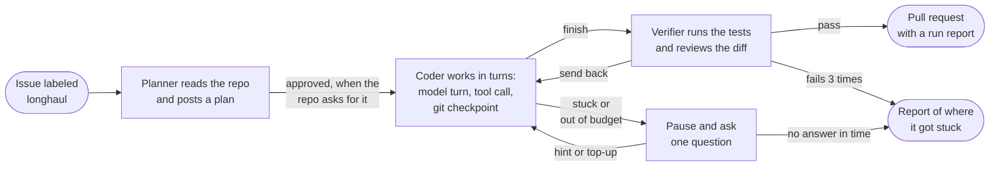

# Longhaul

**A background coding agent that survives crashes and tells you when it is stuck.**

[](https://github.com/hoomanesteki/longhaul-autonomous-coding-agent-github/actions/workflows/ci.yml)

Coding agents can fix many small, well-specified issues, but someone still has to watch them: a run that dies loses its work, and a run that loops keeps spending without telling anyone. Longhaul makes an agent safe to leave alone. In a chaos suite of 20 runs, 18 took a kill of the worker, the sandbox, Temporal or Postgres in the middle of a task, and all 20 still ended with a pull request and the same diff as a run with no kill.

Status: all ten phases (0 to 9) are done, and [`v1.0.0`](https://github.com/hoomanesteki/longhaul-autonomous-coding-agent-github/releases/tag/v1.0.0) is the release. Docs site: [hoomanesteki.github.io/longhaul-autonomous-coding-agent-github](https://hoomanesteki.github.io/longhaul-autonomous-coding-agent-github/).

[How it works](#how-it-works) · [Proof](#proof) · [See it](#see-it) · [Quickstart](#quickstart) · [Run on your repo](#run-on-your-repo) · [Status](#status-and-limitations) · [Docs map](#docs-map)

## How it works

You put the `longhaul` label on a GitHub issue. A poller picks it up and starts one workflow for it in Temporal, a workflow engine that records every step and replays the workflow after a crash. The workflow only decides what runs next. Each model turn, tool call, checkpoint and GitHub write is a separate step (an activity), so when a worker dies, Temporal retries that one step from the last checkpoint and the task goes on.



A person steers from the issue (`/longhaul approve`, `hint`, `budget`, `cancel`) or from the console. The system context, every step of the workflow and the data stores are drawn in [docs/architecture.md](docs/architecture.md).

## Proof

The chaos suite ran 20 times over four recorded tasks, each with one to three kills planned, of the worker, the sandbox, Temporal or Postgres (`eval/results/chaos-2026-11-07`, seed 7).


| Kill type | Kills landed / planned | Runs hit | Completed | Diff equal | Duplicate side effects | Resume p50 / p95 |
|---|---|---|---|---|---|---|
| Worker SIGKILL | 10 / 10 | 8 | 8 / 8 | 8 / 8 | 0 | 16.6 s / 21.8 s |
| Sandbox kill | 11 / 12 | 10 | 10 / 10 | 10 / 10 | 0 | 0.4 s / 22.1 s |
| Temporal restart | 9 / 12 | 7 | 7 / 7 | 7 / 7 | 0 | 2.0 s / 10.5 s |
| Postgres restart | 9 / 11 | 6 | 6 / 6 | 6 / 6 | 0 | 1.4 s / 34.6 s |
| **All** | 39 / 45 | 18 | 20 / 20 | 20 / 20 | 0 | 2.0 s / 22.1 s |

- **No write twice.** 0 duplicate GitHub writes and 0 missing ones, counted from the state of a fake GitHub and not from our own tables.
- **18 of 20 runs took a kill, and all 18 finished.** In the other two, none of the planned kills landed before the run ended, so they show nothing about a crash.
- **The limit.** The model answers were scripted recordings, so the suite measures durability and not how well a model codes. The model evaluation (resolve rate on a SWE-bench Verified subset against a naive loop, and dollars per resolved task) is pending: it needs an API key and the eval VM. [docs/results.md](docs/results.md) lists the commands that make it.

<details><summary>How to read the table</summary>

"Runs hit" counts the runs in which a kill of that type landed, and in that row "Completed" and "Diff equal" count those runs. The All row counts every run in those two columns, including the two that no kill hit. "Duplicate side effects" are the writes on the fake GitHub beyond the ones a task makes. "Resume" runs from the end of a kill to the start of the next activity. The worker latency is mostly the 20 second heartbeat timeout of these runs, which is how long Temporal waits before it decides the activity is dead.

`scripts/chaos_chart.py` draws the chart from the summary file, and a test checks that the two agree. The method is in [eval/chaos/README.md](eval/chaos/README.md).

</details>

## See it

A React console lists every task, shows its timeline turn by turn, and holds the forms to approve a plan, send a hint, add budget or cancel. These screenshots come from the demo stack, which runs the scripted provider, so every cost on them is $0.00.


| A shipped task, one line per event | A paused task with its forms |
|---|---|
|  |  |

More screens (the Needs you filter, the memory viewer, the sign-in page, the 375 px layout) are in the [Phase 8](docs/gates/phase-8.md#screenshots) and [Phase 9](docs/gates/phase-9.md#screenshots) gate reports. To run the console, see "The console" in [docs/runbook.md](docs/runbook.md).

### Demo

A 30-second GIF of the path from a labeled issue to a pull request will live at `docs/media/demo.gif`, with a two-minute video after it. Neither is recorded yet: both show a live model on a real repo, which needs an API key and a recording session. [docs/demo-script.md](docs/demo-script.md) has the script. Until then, `make demo` runs one task end to end on a toy repo with scripted answers and prints the final diff.

## Quickstart

You need Docker, [uv](https://docs.astral.sh/uv/) and Python 3.12. No API key and no GitHub account: the scripted provider plays a fixed set of model answers.

```bash
git clone https://github.com/hoomanesteki/longhaul-autonomous-coding-agent-github.git
cd longhaul-autonomous-coding-agent-github
make setup && make up && make demo
```

- `make setup` installs the dependencies and the pre-commit hooks, and copies `.env.example` to `.env` when there is no `.env`.
- `make up` starts Postgres, Temporal and MinIO, plus an OpenTelemetry collector, Jaeger, Prometheus and Grafana. The first run pulls the images.
- `make demo` runs one task on the `calc` fixture, a small package whose `add()` subtracts. It prints each status line and the final diff, then stops the worker. Nothing stays running.

<details><summary>Network, ports and other commands</summary>

The sandbox setup installs pytest from PyPI, so the machine needs outbound network for the first minute of the task. If another project already uses a port, edit the `LH_*_PORT` values in `.env`. A new `LH_POSTGRES_PORT`, `LH_TEMPORAL_PORT` or `LH_MINIO_PORT` also needs the same port in `LONGHAUL_DATABASE_URL`, `LONGHAUL_TEMPORAL_ADDRESS` or `LONGHAUL_BLOB_ENDPOINT`, because those settings keep the default ports otherwise. A new `LH_OTLP_GRPC_PORT` also needs the same port in `OTEL_EXPORTER_OTLP_ENDPOINT`, or the traces go to whatever listens on port 4317. The Grafana, Prometheus and Jaeger ports can change on their own. `make down` stops the stack and removes its volumes.

```bash
make check          # lint, format check, mypy, unit tests with coverage
make itest          # integration tests against the local stack
make e2e            # end-to-end tests with the scripted provider
make gate PHASE=9   # everything for phases 0 to 9
```

</details>

## Run on your repo

1. **Make a token.** A fine-grained personal access token for the repos you allow, with read and write on Contents, Issues and Pull requests ([ADR-0012](docs/adr/0012-github-auth.md); a GitHub App is the option for a shared deployment).
2. **Write the config.** Copy `config/longhaul.example.yaml` to `longhaul.yaml` and replace the `repos` entries with yours. Each entry sets `allowlisted`, `setup_command`, `test_command`, `plan_approval_required` and its budgets. A repo that is not in the file is never read.
3. **Set the secrets** in your shell or in `.env`, never in the config. Every model in the config needs a price in `config/pricing.yaml`, and memory needs `uv sync --extra memory`.

   ```bash
   export LONGHAUL_GITHUB_TOKEN=github_pat_...
   export LONGHAUL_PROVIDER=anthropic
   export ANTHROPIC_API_KEY=...
   export LONGHAUL_CONFIG=longhaul.yaml
   ```

4. **Start the worker and the poller.**

   ```bash
   uv run longhaul worker              # shell 1
   uv run longhaul poller install      # shell 2: creates the Schedule, once
   ```

5. **Label an issue** `longhaul`. The next poll picks it up, posts a plan, and waits for `/longhaul approve` when the repo asks for approval. The issue commands and the console (`longhaul api` with `LONGHAUL_ADMIN_TOKEN`) are in [docs/runbook.md](docs/runbook.md).

## How it is built

Four ideas carry it:

- **Durable turns.** Each model turn and tool call has its own timeout, retry policy and heartbeat.
- **Git checkpoints.** Every change in the workspace becomes a commit in a bare repo per task. A retried tool call first resets the workspace to the commit made just before it, so it never runs on half-applied edits.
- **Two-tier context.** Old tool outputs shrink to a one-line stub with a handle, and old turns become structured progress notes, so a task of a hundred turns fits the window.
- **Plan, verify, stuck.** A planner, a coder and a verifier run as roles inside one workflow. A stuck detector pauses the task and asks one specific question, and hard budgets stop the spend.

### Safety

- **Sandbox.** Repo code runs only in a Docker container: non-root user, all capabilities dropped, `no-new-privileges`, read-only root filesystem, limits on processes, memory and CPU. The network is cut after the setup command.
- **No credentials inside.** The GitHub token and model keys stay in the worker. The sandbox environment is an allowlist, and a test checks it holds no secret.
- **Writes go one way.** Every GitHub write carries an idempotency key, and the agent never pushes to a default branch. A person merges the pull request.
- **Budgets.** Each task has limits on dollars, turns and wall time, and each repo has a daily dollar limit. A task at a task limit pauses and asks; a task at the daily repo limit waits until 00:00 UTC.
- **Memory.** Notes from unmerged work are candidates and never reach a prompt until a merged pull request or a person approves them.

The threat model, the test behind each control and the known gaps are in [docs/security.md](docs/security.md).

### Design decisions

Each non-obvious choice has a short record with the alternatives in [docs/adr/](docs/adr/).

<details><summary>All 13 decisions, one line each</summary>

| ADR | Decision |
|---|---|
| [0001](docs/adr/0001-record-decisions.md) | Every non-obvious choice gets a short record in the same pull request as the code. |
| [0002](docs/adr/0002-pin-dependencies.md) | Dependencies are pinned at project start, and upgrades get their own pull request. |
| [0003](docs/adr/0003-own-agent-loop.md) | Our own loop on the Messages API, because the unit of durability is one model turn and one tool call. |
| [0004](docs/adr/0004-temporal.md) | Temporal for durable execution: replay, retries, heartbeats, signals, schedules and Continue-As-New. |
| [0005](docs/adr/0005-payloads-by-reference.md) | Transcripts and tool output go to the blob store, and workflows pass references under 256 KB. |
| [0006](docs/adr/0006-git-checkpoints.md) | A bare repo per task, a micro-commit after every mutating call, and a hard reset to `pre_sha` before any retry. |
| [0007](docs/adr/0007-roles-in-one-workflow.md) | Planner, coder and verifier are roles inside one workflow and not child workflows. |
| [0008](docs/adr/0008-polling.md) | Poll GitHub every 60 seconds instead of taking webhooks, so no public endpoint is needed. |
| [0009](docs/adr/0009-sandbox-model.md) | One hardened container per task, no network after setup, and no credentials inside. |
| [0010](docs/adr/0010-memory-write-policy.md) | Only approved memory reaches a prompt, and approval comes from the default branch, a merged pull request or a person. |
| [0011](docs/adr/0011-console-stack.md) | A React, Vite and TypeScript console with API types generated from the OpenAPI schema. |
| [0012](docs/adr/0012-github-auth.md) | A fine-grained token for development, a GitHub App for shared use, and the token stays in the worker. |
| [0013](docs/adr/0013-context-strategy.md) | Two tiers of context control, with every cut at a turn where each tool call has its result. |

</details>

## Status and limitations

Every story in [docs/progress.md](docs/progress.md) is done. Each phase gate has a tag and a [GitHub Release](https://github.com/hoomanesteki/longhaul-autonomous-coding-agent-github/releases), from `v0.0.1` to `v1.0.0`. The owner runs two scripts once with `gh` logged in: [branch protection](docs/runbook.md#branch-protection), as a repo admin, and the [backlog import](docs/runbook.md#backlog-import), which needs write access.

- **Python repos only.** The sandbox image is Python 3.12 and the setup command installs the repo with pip.
- **One host.** A worker needs a Docker daemon next to it. The Terraform in `deploy/terraform/aws` is validated in CI and applied by hand ([docs/deploy-aws.md](docs/deploy-aws.md)).
- **Polling delay.** A labeled issue waits up to a minute for its task, and a comment command up to a minute for its effect.
- **Not measured or recorded yet.** The model evaluation is pending. When it runs, it covers a 40-task subset of SWE-bench Verified and 15 custom tasks, which gives wide intervals. The demo video and GIF are not recorded.

## Docs map

The [docs site](https://hoomanesteki.github.io/longhaul-autonomous-coding-agent-github/) renders the same files with a grouped navbar.

| Doc | What it holds |
|---|---|
| [docs/case-study.md](docs/case-study.md) | The story in one page: the problem, what was built, the proof, what did not work |
| [docs/architecture.md](docs/architecture.md) | The system context, the task workflow and the data stores, plus contracts, tracing, logs and metrics |
| [docs/adr/](docs/adr/) | One record per design choice, with the alternatives that were rejected |
| [docs/results.md](docs/results.md) | The page the report builder writes from eval results, with the commands for the pending runs |
| [docs/gates/](docs/gates/) | The review at the end of each phase: what passed, what failed and what was fixed |
| [docs/runbook.md](docs/runbook.md) | How to run, steer, observe, upgrade and publish Longhaul |
| [docs/security.md](docs/security.md) | The threat model, each control and the test behind it, and the known gaps |
| [docs/deploy-aws.md](docs/deploy-aws.md) | The Terraform for AWS: what it builds, what it costs, how to apply and tear it down |
| [docs/demo-script.md](docs/demo-script.md) | The two-minute video and the GIF, with the recording checklist |
| [docs/plan/longhaul-build-plan.md](docs/plan/longhaul-build-plan.md) | The build plan: phases, stories, acceptance criteria and the evaluation method |
| [docs/progress.md](docs/progress.md) | The status of every story |
| [CONTRIBUTING.md](CONTRIBUTING.md) and [docs/style.md](docs/style.md) | The working rules and the voice of the docs |

<details><summary>Repo layout</summary>

| Path | What it holds |
|---|---|
| `src/longhaul/` | The package: contracts, providers, sandbox, tools, workflows and activities, GitHub, context, roles, memory, cost, telemetry, API and CLI |
| `console/` | The React console |
| `eval/` and `tests/` | The eval runner, baselines, chaos suite and committed results; unit, integration, end-to-end and chaos tests with toy fixture repos |
| `config/` and `deploy/` | Example `longhaul.yaml`, the pricing table, and Terraform for AWS |
| `docs/` and `site/` | The docs, and the Quarto site that renders them (`make site`) |
| `scripts/` | The demo, the kill-the-worker script, backlog import, fixture builders and the site scripts |

</details>

## Development

One story per branch (`feat/lh-<id>-<slug>`), merged into `dev`. `main` only moves when a phase gate passes, and each gate is tagged. The rules are in [CONTRIBUTING.md](CONTRIBUTING.md), and CI and the day-to-day commands are in [docs/runbook.md](docs/runbook.md).

## License

MIT
