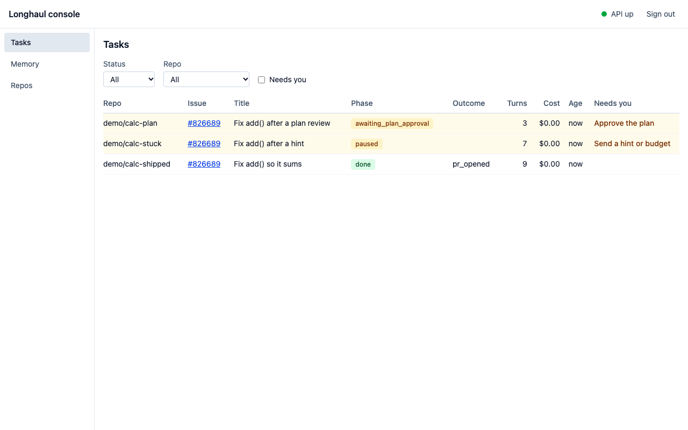
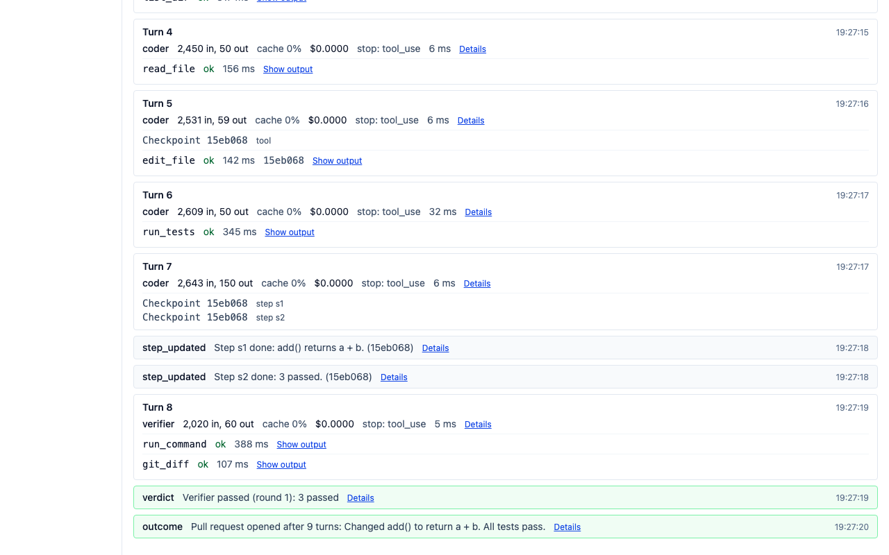
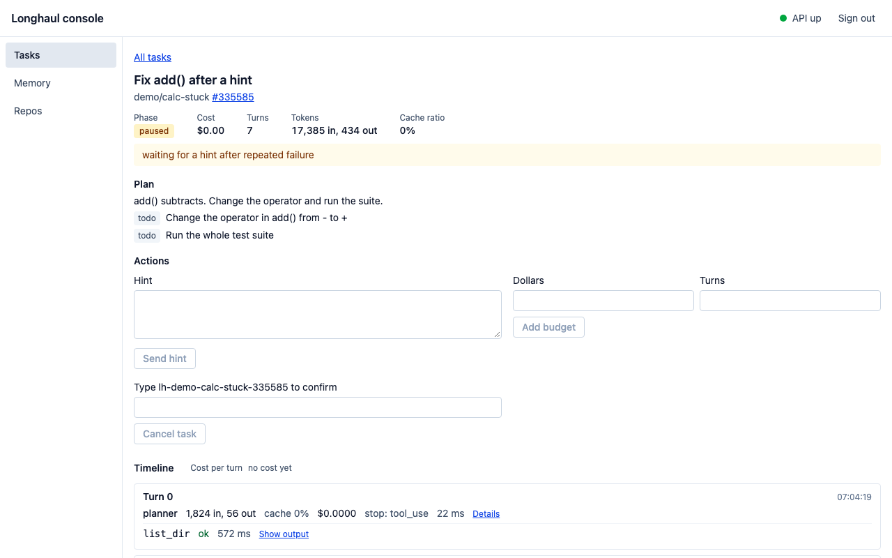

# Longhaul

**A background coding agent that survives crashes and tells you when it is stuck.**

Coding agents can fix many small, well-specified issues, but someone still has to watch them: a run that dies loses its work, and a run that loops keeps spending without telling anyone. Longhaul makes an agent safe to leave alone. It takes a GitHub issue, works on it for hours in a sandbox, resumes where it stopped after a crash, asks a person only at checkpoints, and ends with a pull request or an honest report of where it got stuck. In 20 chaos runs, each set to kill the worker, the sandbox, Temporal or Postgres in the middle of a task, all 20 ended with a pull request and the same diff as a run with no kill, and no GitHub write happened twice.

Status: phases 1 to 9 are done, and `v1.0.0` is the release. Two Phase 0 stories (LH-003 and LH-006) wait on the owner's steps on GitHub. The repo is public. Docs site: [hoomanesteki.github.io/longhaul-autonomous-coding-agent-github](https://hoomanesteki.github.io/longhaul-autonomous-coding-agent-github/), built from `docs/` with Quarto and published by GitHub Pages on each push to `main` (the runbook's [Publishing](docs/runbook.md#publishing) section).

[](https://github.com/hoomanesteki/longhaul-autonomous-coding-agent-github/actions/workflows/ci.yml)

[How it works](#how-it-works) · [Proof](#headline-numbers) · [The console](#the-console) · [Quickstart](#quickstart) · [Run on your repo](#run-on-your-repo) · [Docs map](#docs-map)

## Headline numbers

The only measured result so far is the chaos suite: 20 runs of four recorded tasks, each hit with one to three kills of the worker, the sandbox, Temporal or Postgres (`eval/results/chaos-2026-11-07`, seed 7).

- 20 of 20 runs ended with a pull request, and each had the same final diff as the same task run with no kill.
- 0 duplicate GitHub writes and 0 missing ones, counted from the state of a fake GitHub and not from our own tables.
- 39 of 45 planned kills landed. 18 of 20 runs count as survived: in two runs none of the planned kills landed before the run ended, so they show nothing about a crash.
- Resume latency, from the end of a kill to the start of the next activity: median 2.0 s, 95th percentile 22.1 s.


What this means: a crash costs a task the step it was in and a short wait, not its work and not a second comment or pull request. The model answers in those runs were scripted recordings, not a live model, so the suite measures durability and not how well a model codes. `scripts/chaos_chart.py` draws the chart from the summary file, and a test checks that the two agree.

The resolve rate against a naive loop on a SWE-bench Verified subset, and the dollars per resolved task, are pending. They need an API key, and the SWE-bench runs need the eval VM, so the runs are not made yet. The commands that make them are in [docs/results.md](docs/results.md), and the tables appear on that page once the runs exist. Nothing here is estimated.

## Demo

A 30-second GIF of the path from a labeled issue to a pull request will live at `docs/media/demo.gif`, and a two-minute video will follow it. Neither is recorded yet, because both show a live model on a real repo, which needs an API key and a recording session. The script for them is [docs/demo-script.md](docs/demo-script.md). Until then, `make demo` in the [Quickstart](#quickstart) runs the same path on a toy repo, and [The console](#the-console) shows the screens.

## How it works

A poller finds the issues that carry the `longhaul` label and starts one Temporal workflow for each. The workflow only decides what runs next. Each model turn, tool call, checkpoint and write to GitHub is an activity of its own, so when a worker dies, Temporal retries that one step from the last checkpoint and the task goes on.


Four ideas carry it:

- **Durable turns.** Every model turn and every tool call is its own Temporal activity with a timeout, a retry policy and a heartbeat. The workflow only schedules them, so a worker that dies loses one step and not the task.
- **Git checkpoints.** Every change in the workspace becomes a commit in a bare repo per task. A retried tool call starts from its `pre_sha`, so it never runs on half-applied edits.
- **Two-tier context.** Old tool outputs shrink to a one-line stub with a handle, and old turns become structured progress notes, so a task of a hundred turns fits the window.
- **Plan, verify, stuck.** A planner, a coder and a verifier run as roles inside one workflow. A stuck detector pauses the task and asks one specific question, and hard budgets stop the spend.

A person steers from the issue (`/longhaul approve`, `hint`, `budget`, `cancel`) or from the console. Every GitHub write goes through one module with an idempotency key, so a retry never posts twice. The system context, with every service, and each step of the workflow are drawn in [docs/architecture.md](docs/architecture.md). The plan with every story is [docs/plan/longhaul-build-plan.md](docs/plan/longhaul-build-plan.md).

## The console

A React console lists every task, shows its timeline turn by turn, and holds the forms to approve a plan, send a hint, add budget or cancel. These screenshots come from the Phase 8 and Phase 9 gates, taken against the demo stack, which runs the scripted provider, so every cost on them is $0.00.



<table>
  <tr>
    <td width="50%"></td>
    <td width="50%"></td>
  </tr>
  <tr>
    <td>A shipped task: each event reads as one line, with a checkpoint marker on the turn that made it.</td>
    <td>A paused task with the hint, budget and cancel forms.</td>
  </tr>
</table>

The other screens (the Needs you filter, the memory viewer, the sign-in page and the 375 px layout) are in the [Phase 8](docs/gates/phase-8.md#screenshots) and [Phase 9](docs/gates/phase-9.md#screenshots) gate reports. How to run the console is in "The console" in [docs/runbook.md](docs/runbook.md).

## Quickstart

You need Docker, [uv](https://docs.astral.sh/uv/) and Python 3.12. No API key and no GitHub account are needed: the scripted provider plays a fixed set of model answers.

```bash
git clone https://github.com/hoomanesteki/longhaul-autonomous-coding-agent-github.git
cd longhaul-autonomous-coding-agent-github
make setup && make up && make demo
```

- `make setup` installs the dependencies and the pre-commit hooks, and copies `.env.example` to `.env` when there is no `.env`.
- `make up` starts Postgres, Temporal and MinIO, plus Jaeger, Prometheus and Grafana, from `docker-compose.yml`. The first run pulls the images.
- `make demo` builds the sandbox image, creates the database tables, starts a worker, and runs one task on the `calc` fixture, a small package whose `add()` subtracts. It prints each status line and the final diff, then stops the worker. Nothing stays running.

The sandbox setup installs pytest from PyPI, so the machine needs outbound network for the first minute of the task. If another project already uses a port, edit the `LH_*_PORT` values in `.env`. A new `LH_POSTGRES_PORT`, `LH_TEMPORAL_PORT` or `LH_MINIO_PORT` also needs the same port in `LONGHAUL_DATABASE_URL`, `LONGHAUL_TEMPORAL_ADDRESS` or `LONGHAUL_BLOB_ENDPOINT`, because those settings keep the default ports otherwise. A new `LH_OTLP_GRPC_PORT` also needs the same port in `OTEL_EXPORTER_OTLP_ENDPOINT`, or the traces go to whatever listens on port 4317. The Grafana, Prometheus and Jaeger ports can change on their own. `make down` stops the stack and removes its volumes.

Other commands:

```bash
make check          # lint, format check, mypy, unit tests with coverage
make itest          # integration tests against the local stack
make e2e            # end-to-end tests with the scripted provider
make gate PHASE=9   # everything for phases 0 to 9
```

## Run on your repo

1. **Make a token.** Create a fine-grained personal access token for the repos you allow, with read and write on Contents, Issues and Pull requests. Metadata read comes with every token. ADR-0012 explains the choice, and a GitHub App is the option for a shared deployment.
2. **Write the config.** Copy `config/longhaul.example.yaml` to `longhaul.yaml`, replace the `repos` entries with yours, and point `LONGHAUL_CONFIG` at the copy. Each repo entry sets `allowlisted`, `setup_command`, `test_command`, `plan_approval_required` and its budgets. A repo that is not in the file is never read.
3. **Set the secrets** in your shell or in `.env`, never in the config:

   ```bash
   export LONGHAUL_GITHUB_TOKEN=github_pat_...
   export LONGHAUL_PROVIDER=anthropic
   export ANTHROPIC_API_KEY=...
   export LONGHAUL_CONFIG=longhaul.yaml
   ```

   Every model in the config needs a price in `config/pricing.yaml`, and the worker stops at start when one is missing. Memory uses a local embedder, which needs `uv sync --extra memory`.
4. **Start the worker and the poller.**

   ```bash
   uv run longhaul worker              # shell 1
   uv run longhaul poller install      # shell 2: creates the Schedule, once
   ```

5. **Label an issue** `longhaul`. The next poll picks it up, posts a plan, and waits for `/longhaul approve` when the repo asks for approval. The commands you can type on the issue are in the runbook ("Steer a task from its issue").

The console shows every task, its timeline and the notes it remembers. It needs `LONGHAUL_ADMIN_TOKEN` and `longhaul api`; see "The console" in [docs/runbook.md](docs/runbook.md).

## Results

[docs/results.md](docs/results.md) is built by `eval/report/build_report.py` from committed result files, and every number on it comes from those files. It has no tables yet, because the SWE-bench and custom-set runs need an API key and are not made. It lists the commands that make them.

The chaos table below is from `eval/results/chaos-2026-11-07`, with scripted model answers, and the chart under [Headline numbers](#headline-numbers) draws the same numbers. The method is in [eval/chaos/README.md](eval/chaos/README.md).

| Kill type | Kills landed / planned | Runs hit | Completed | Diff equal | Duplicate side effects | Resume p50 / p95 |
|---|---|---|---|---|---|---|
| Worker SIGKILL | 10 / 10 | 8 | 8 / 8 | 8 / 8 | 0 | 16.6 s / 21.8 s |
| Sandbox kill | 11 / 12 | 10 | 10 / 10 | 10 / 10 | 0 | 0.4 s / 22.1 s |
| Temporal restart | 9 / 12 | 7 | 7 / 7 | 7 / 7 | 0 | 2.0 s / 10.5 s |
| Postgres restart | 9 / 11 | 6 | 6 / 6 | 6 / 6 | 0 | 1.4 s / 34.6 s |
| **All** | 39 / 45 | 18 | 20 / 20 | 20 / 20 | 0 | 2.0 s / 22.1 s |

How to read it: "Runs hit" counts the runs in which a kill of that type landed, and "Completed" and "Diff equal" count those runs. "Duplicate side effects" are the writes on the fake GitHub beyond the ones a task makes. The worker latency is mostly the 20 second heartbeat timeout of these runs, which is how long Temporal waits before it decides the activity is dead.

## Design decisions

One line each. The full records, with the alternatives, are in [docs/adr/](docs/adr/).

- [ADR-0001](docs/adr/0001-record-decisions.md): every non-obvious choice gets a short record in the same pull request as the code.
- [ADR-0002](docs/adr/0002-pin-dependencies.md): dependencies are pinned at project start, and upgrades get their own pull request.
- [ADR-0003](docs/adr/0003-own-agent-loop.md): our own loop on the Messages API, because the unit of durability is one model turn and one tool call.
- [ADR-0004](docs/adr/0004-temporal.md): Temporal for durable execution, for replay, retries, heartbeats, signals, schedules and Continue-As-New.
- [ADR-0005](docs/adr/0005-payloads-by-reference.md): transcripts and tool output go to the blob store, and workflows pass references under 256 KB.
- [ADR-0006](docs/adr/0006-git-checkpoints.md): a bare repo per task, a micro-commit after every mutating call, and a hard reset to `pre_sha` before any retry.
- [ADR-0007](docs/adr/0007-roles-in-one-workflow.md): planner, coder and verifier are roles inside one workflow and not child workflows.
- [ADR-0008](docs/adr/0008-polling.md): poll GitHub every 60 seconds instead of taking webhooks, so no public endpoint is needed.
- [ADR-0009](docs/adr/0009-sandbox-model.md): one hardened container per task, no network after setup, and no credentials inside.
- [ADR-0010](docs/adr/0010-memory-write-policy.md): only approved memory reaches a prompt, and approval comes from the default branch, a merged pull request or a person.
- [ADR-0011](docs/adr/0011-console-stack.md): a React, Vite and TypeScript console with API types generated from the OpenAPI schema.
- [ADR-0012](docs/adr/0012-github-auth.md): a fine-grained token for development, a GitHub App for shared use, and the token stays in the worker.
- [ADR-0013](docs/adr/0013-context-strategy.md): two tiers of context control, with every cut at a turn where each tool call has its result.

## Safety

- **Sandbox.** Repo code runs only in a Docker container: non-root user, all capabilities dropped, `no-new-privileges`, read-only root filesystem, limits on processes, memory and CPU. The network is on for the setup command and cut after it.
- **No credentials inside.** The GitHub token and model keys live in the worker environment. The sandbox environment is an allowlist, and a test checks it holds no secret.
- **Writes go one way.** Every GitHub write goes through one module with an idempotency key, so a retry cannot post twice. The agent never pushes to a default branch.
- **Budgets.** Each task has limits on dollars, turns and wall time, and each repo has a daily dollar limit. A task that reaches a task limit pauses and asks. A task that reaches the daily repo limit waits until 00:00 UTC.
- **A person merges.** Longhaul opens the pull request. It does not merge it.
- **Memory.** Notes from unmerged work are candidates and never reach a prompt until a merged pull request or a person approves them.

The threat model, the test behind each control and the known gaps are in [docs/security.md](docs/security.md).

## Limitations

- Python repos only. The sandbox image is Python 3.12 and the setup command installs the repo with pip.
- One host. A worker needs a Docker daemon next to it. The Terraform in `deploy/terraform/aws` is checked for validity in CI and applied by hand ([docs/deploy-aws.md](docs/deploy-aws.md)).
- Polling delay. A labeled issue waits up to a minute for its task, and a comment command up to a minute for its effect.
- The eval numbers are pending, and the chaos runs used scripted model answers. When the eval runs are made, they cover a 40-task subset of SWE-bench Verified and a set of 15 custom tasks, which gives wide intervals.
- The repo is public, but the demo video, the `v1.0.0` tag, the release notes and the live docs site are not done. They are steps at the `v1.0.0` gate.

## Docs map

| Doc | What it holds |
|---|---|
| [docs/case-study.md](docs/case-study.md) | The story in one page: the problem, what was built, the proof, what did not work, and the decisions worth defending |
| [docs/architecture.md](docs/architecture.md) | The system context, the task workflow and the data stores as diagrams, plus the contracts, tracing, logs and metrics |
| [docs/adr/](docs/adr/) | One record per design choice, with the alternatives that were rejected |
| [docs/results.md](docs/results.md) | The page the report builder writes from eval results, with the commands that make the pending runs |
| [eval/chaos/README.md](eval/chaos/README.md) | How the chaos suite kills, counts and measures, and what each field of its results means |
| [docs/gates/](docs/gates/) | The review at the end of each phase: what passed, what failed and what was fixed |
| [docs/runbook.md](docs/runbook.md) | How to run, steer, observe, upgrade and publish Longhaul, one task at a time or as a service |
| [docs/security.md](docs/security.md) | The threat model, each control and the test behind it, and the known gaps |
| [docs/deploy-aws.md](docs/deploy-aws.md) | The Terraform for AWS: what it builds, what it costs, and how to apply and tear it down |
| [docs/demo-script.md](docs/demo-script.md) | The two-minute video and the GIF, with the checklist of what is still open |
| [docs/plan/longhaul-build-plan.md](docs/plan/longhaul-build-plan.md) | The build plan: phases, stories, acceptance criteria and the evaluation method |
| [docs/progress.md](docs/progress.md) | The status of every story |
| [CONTRIBUTING.md](CONTRIBUTING.md) and [docs/style.md](docs/style.md) | The working rules and the voice of the docs |

The docs site renders the same files with a grouped navbar, once GitHub Pages is on (see the Status line at the top).

## Repo layout

| Path | What it holds |
|---|---|
| `src/longhaul/` | The package: contracts, providers, sandbox, tools, durable workflows and activities, GitHub, context, roles, memory, cost, telemetry, API and CLI |
| `console/` | The React console |
| `eval/` | The eval runner, baselines, the chaos suite, the report builder and committed results |
| `tests/` | Unit, integration, end-to-end and chaos tests, plus toy fixture repos with planted bugs |
| `config/` | Example `longhaul.yaml` and the pricing table |
| `docs/` | Architecture, runbook, security, results, decisions, gate reports and the plan |
| `deploy/` | Terraform for AWS |
| `site/` | The Quarto docs site, which renders the files of `docs/` (`make site`) |
| `scripts/` | The demo, the kill-the-worker script, backlog import, fixture builders and the docs site scripts |

## Development

One story per branch (`feat/lh-<id>-<slug>`), merged into `dev`. `main` only moves when a phase gate passes, and each gate is tagged. Contribution rules are in [CONTRIBUTING.md](CONTRIBUTING.md). CI and the day-to-day commands are in [docs/runbook.md](docs/runbook.md).

## License

MIT
