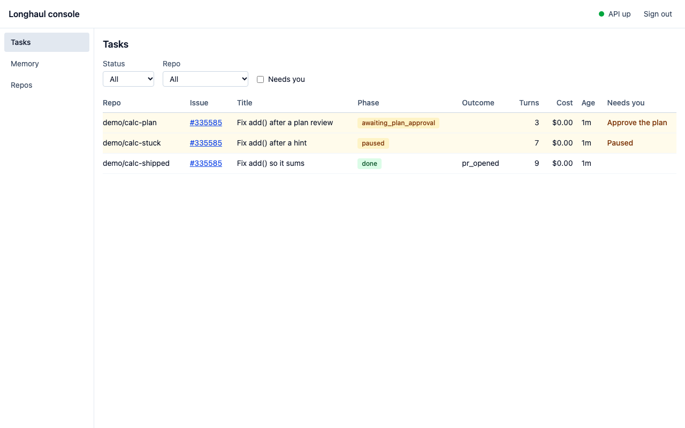
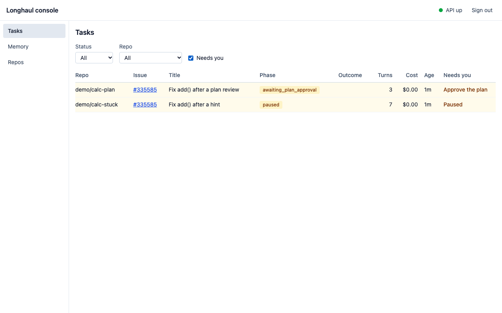
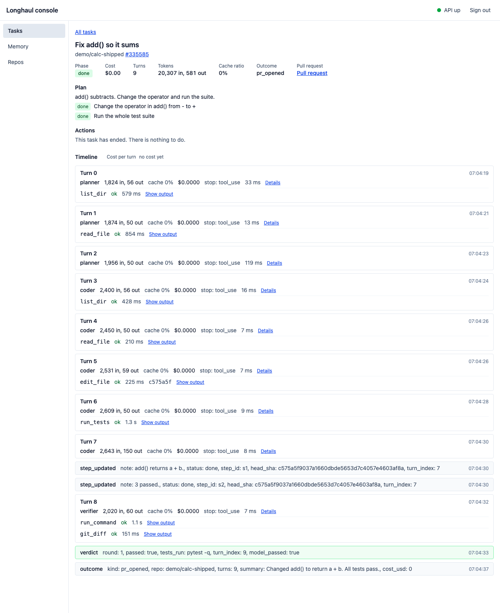
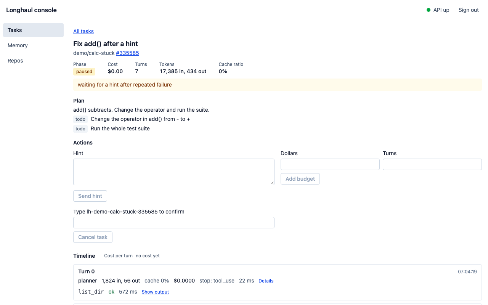
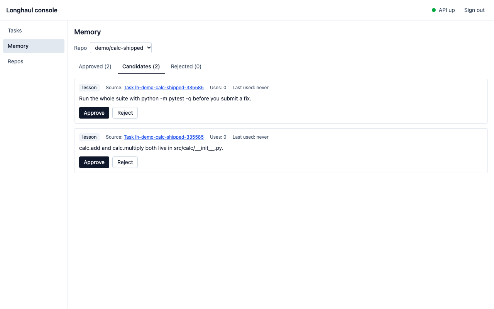
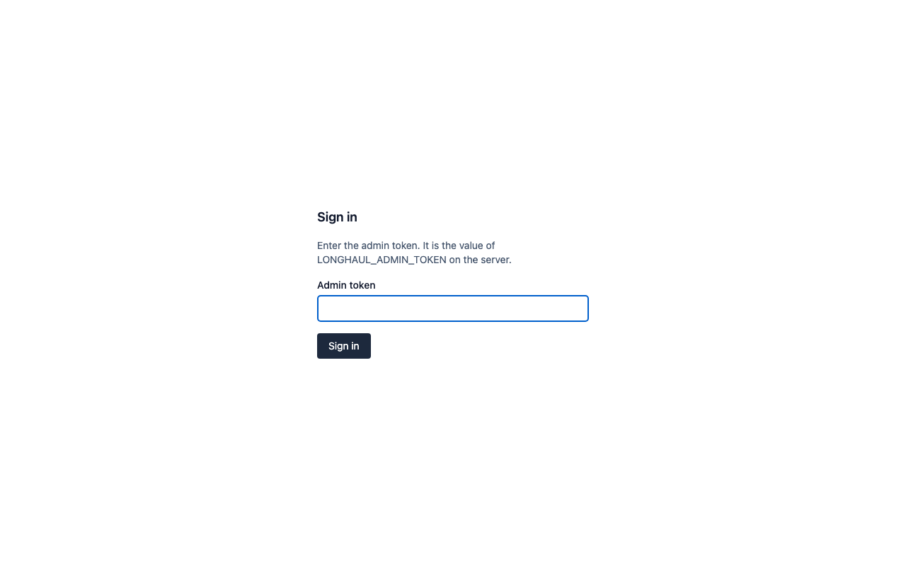
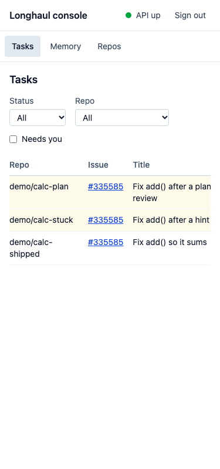

# Phase 8 gate: Console

- Date: 2026-11-09
- Result: **Pass.** One manual smoke is left, the compose `full` profile on this machine (see "Steps to close the gate").

## Test summary

| Check | Result |
|---|---|
| `make gate PHASE=8`, console line at 61f9d80 (first run) | Green: 6644 unit tests; the marker run had 6841 passed and 0 failed. That gate did not run the console checks; the review ran them by hand (151 vitest tests, the build, the Playwright main path), and found the issues below. |
| `make gate PHASE=8`, dev at e9c6796 with LH-891 (second run) | ruff, ruff format and mypy clean; 6752 unit tests passed; the marker run had 6928 passed, 1 failed and 1 error in 44 minutes. Both came from the machine sleeping during the run (on battery with the lid closed): the Docker VM clock fell 688 s behind the host, which failed test_write_file_stamps_a_current_mtime, and the Temporal test server did not start within 5 s for test_the_base_of_the_pull_request_is_kept_across_a_hand_over. With the clocks back in step both passed on rerun. The gate stopped there, so its console steps were run by hand: console-check passed (lint, typecheck, 157 vitest tests, build); console-e2e timed out waiting for the demo stack while the machine slept again, so the Playwright evidence is the CI run below. |
| GitHub Actions `ci` | All jobs green on dev at e9c6796, the same tree: unit, integration, e2e, console (lint, typecheck, tests, build, type generation check), console-e2e (the Playwright main path, list rows included), lint, types, security, docs, compose, terraform. |
| Replay | Histories recorded before the console mirror (LH-805) and before the task row (LH-891) replay, and fail with a nondeterminism error when either patch check is removed. They are committed under tests/fixtures/histories/. |
| Auth probe | Every `/api` route answers 401 without the token; 30 POSTs a minute per token, then 429; no CORS; the docs routes are off unless `LONGHAUL_API_DOCS` turns them on. |

## Acceptance criteria

| Story | Criterion | Evidence | Status |
|---|---|---|---|
| LH-801 | Every endpoint has a test against a seeded DB and a time-skipping Temporal env | tests/integration/test_api.py: 21 tests, among them test_tasks_list_filters, test_task_detail_live_status, test_timeline_order, test_outputs_redacted, test_memory_approve_and_reject and test_repos_healthz_and_metrics. All passed (run 3). LH-801 was already on dev and is re-run here on the merged tree. | Pass |
| LH-801 | The POST actions deliver the right signal (asserted via workflow state) | test_api.py::test_actions_signal and ::test_cancel_action_ends_the_task passed | Pass |
| LH-801 | Turn and output endpoints apply redaction | test_api.py::test_outputs_redacted passed. tests/unit/test_api_redaction.py passed (run 4). | Pass |
| LH-802 | npm run build passes in CI | The `console` job (npm ci, type generation check, lint, typecheck, test, build) is green on dev at e9c6796. | Pass |
| LH-802 | A type change in openapi.json that breaks a call fails npm run typecheck | Mutation (run 7): renaming the HintRequest field makes typecheck exit 2 (TS2353 at TaskActions.tsx:170). console/src/__tests__/client.types.test.ts ('rejects calls that the generated schema does not allow') and client.test.ts 'adds bearer header' pass. | Pass |
| LH-803 | Component tests cover rendering, filters and the needs-you toggle with mocked data | console/src/pages/__tests__/TasksPage.test.tsx: 19 tests passed (rows and columns, status and repo filters, needs-you toggle, 10 s polling, empty and error states) | Pass |
| LH-803 | It works at 375 px width (horizontal scroll inside the table only) | TasksPage.test 'scrolls the table sideways and not the page' checks only CSS classes. My Playwright probe at 375 px (run 8): the page's scrollWidth is 375, and the 896 px table scrolls inside a 343 px wrapper. Screenshot tasks-375.png. | Pass |
| LH-804 | Renders a 300-turn fixture without jank (fewer than 100 DOM rows) | TaskPage.test.tsx 'renders a 300-turn fixture with fewer than 100 rows in the page' passed. It asserts more than 0 and fewer than 100 rows, Turn 299 absent, and the sparkline covering all 300 turns. | Pass |
| LH-804 | Expanding a tool output fetches only that output | TaskPage.test.tsx 'fetches only the output of the call that was opened, a page of lines at a time' passed | Pass |
| LH-805 | Buttons appear only for valid phases, and the right endpoint is called with the right body | console/src/components/__tests__/TaskActions.test.tsx: 10 tests passed ('offers the plan decision only while the task waits for one', plus the bodies for approve, reject, hint, budget and cancel) | Pass |
| LH-805 | The workflow posts the mirror comment (integration test through the API) | test_api.py::test_console_hint_mirrored_to_issue passed (key <task>:console:1, body 'Hint from console:'). ::test_console_actions_are_mirrored_one_comment_each and ::test_only_console_actions_of_an_issue_are_mirrored also passed. Replay safety confirmed by run 6. | Pass |
| LH-806 | Approve and reject call the API and move the item between tabs | MemoryPage.test.tsx 'approves a candidate through the API and moves it to Approved' and 'rejects a candidate ... moves it to Rejected' passed. The Playwright step 'approve a lesson' passed against the real API. | Pass |
| LH-806 | The source links resolve to the PR or task page | MemoryPage.test.tsx 'source links': 6 tests passed (PR number, merged PR, task id to /tasks/:id, default-branch sha, none for a manual item, none for an unknown shape) | Pass |
| LH-807 | Missing or wrong token returns 401 on every /api route | tests/integration/test_api_auth.py::test_requires_token, parametrized over all 14 /api routes from the OpenAPI schema (missing, wrong, Basic, empty), passed, along with its guard test_the_route_list_covers_reads_and_actions. Probe (run 9): with the console mounted, unknown /api paths return 404 or 405 and never data. | Pass |
| LH-807 | Rate limiting returns 429 after 30 POSTs per minute | test_api_auth.py::test_rate_limit_actions (31st is 429 with Retry-After 60, sliding window) and ::test_a_refused_request_does_not_use_up_the_limit passed | Pass |
| LH-808 | The Playwright test passes locally and in CI on dev | The `console-e2e` job is green on dev at e9c6796. Locally it passed in the gate review (on 61f9d80) and in the LH-891 build; the run in this gate timed out while the machine slept (see the test summary). | Pass |
| Integration checkpoint 8 | make gate PHASE=8 covers all backend e2e, chaos_lite, console unit tests and the Playwright main path | Fixed by LH-891: for phases 8 and 9 the gate runs `console-check` and `console-e2e` after pytest, pinned by tests/unit/test_makefile_gate.py. | Pass |
| Integration checkpoint 8 | Manual smoke: make up, docker compose --profile full up -d api worker, seed_demo.sh, walk the main path at :8000 | Not run: it would start compose services on the shared machine. The seeded stack behind the Playwright run is the same flow on port 8792. | Manual |
| Phase gate 8 | All 8 stories Done. ADR-0011 merged | docs/progress.md lists LH-801 to LH-808 as Done, and docs/adr/0011-console-stack.md is on dev. | Pass |
| Phase gate 8 | Playwright green. Console screenshots in the gate report. Tag v0.8.0 | Playwright is green in CI on e9c6796. The screenshots are below. v0.8.0 is tagged at the dev to main merge of this gate. | Pass |

## Invariants

- I4 (pass): Console actions reach GitHub only through the POST_COMMENT activity. TaskWorkflow._mirror builds the comment with lifecycle.console_comment and _post_mirror runs acts.POST_COMMENT, which is github/side_effects.post_comment. That function redacts the body (side_effects.py:391-395) and is idempotent on the key <task>:console:<n>. tests/unit/test_invariants.py::test_github_writes_only_in_side_effects passed. The mirror tests in test_api.py and test_task_workflow.py (replay posts no second ...
- I5 (pass): The console and API add no git or push path: they only send signals and read the DB, blobs and memory. tests/unit/test_branch_guard.py passed.
- I7 (pass): The memory viewer decides through POST /api/memory/{id}/approve/reject, which calls PgMemoryStore.promote and reject with by='console'. This counts as a person, which ADR-0010 allows. Retrieval still filters to approved items. tests/unit/test_memory_retrieve.py::test_only_approved_in_prompt passed, test_api.py::test_memory_approve_and_reject passed, and the Playwright lesson approval passed.
- Redaction (API never returns secrets) (pass): api/redaction.py wraps telemetry.logging.redact and is applied to turns, tool output (redacted whole, then paged), event payloads, the plan, task settings, the outcome, the live status (paused_reason, summary) and memory content. test_api.py::test_outputs_redacted and tests/unit/test_api_redaction.py passed. The token is excluded from repr (ApiContext admin_token repr=False) and never logged by the API. The demo script does print the token: see minor finding.
- I1 (pass): The new workflow code (_mirror, _post_mirror, _settle_mirrors) imports only lifecycle and CommentInput (pure modules) through imports_passed_through. test_invariants.py::test_workflows_have_no_io_imports passed.
- F13 replay (workflow.patched) (pass): Pre-LH-805 histories with console signals on GitHub tasks, recorded with the dev ba68f16 code, replay on 61f9d80. Without the patch check they fail with TMPRL1100. test_task_workflow.py::test_recorded_histories_replay and ::test_a_replay_posts_no_console_comment_again passed.
- I2 (pass): Mirror bodies quote at most 1,000 characters. Hint and feedback bodies are capped at 10,000 by the API schemas, so signal payloads stay far below 256 KB. test_invariants.py::test_payload_size_guard passed.
- I9 (pass): ruff, ruff format and mypy clean; 6752 unit tests passed; the marker run had 6928 passed, 1 failed and 1 error in 44 minutes. Both came from the machine sleeping during the run (on battery with the lid closed): the Docker VM clock fell 688 s behind the host, which failed test_write_file_stamps_a_current_mtime, and the Temporal test server did not start within 5 s for test_the_base_of_the_pull_request_is_kept_across_a_hand_over. With the clocks back in step both passed on rerun. The gate ...

## Screenshots

Taken with Playwright on dev at e9c6796, against the demo stack of LH-808 (scripted provider, so every cost is $0.00).

The tasks list: each row shows the task's phase, turns, cost and outcome, and the two tasks that need a person are marked.

The Needs you filter: the task waiting on its plan and the paused task.

A shipped task: summary, plan with its steps done, every turn and tool call, the verdict and the outcome.

A paused task with the hint, budget and cancel forms.

The memory viewer on the candidates tab.

The sign-in page.

The tasks list at 375 px: the table scrolls inside its box and the page does not.

## Issues found

1. **The tasks list showed every task as queued.** The poller wrote one `tasks` row at pickup and nothing wrote it again, so the list showed 0 turns, no outcome and no PR, and the Needs you filter was empty while two tasks waited on a person. The Playwright test opened tasks from their pages and missed it. Fixed by LH-891: the workflow keeps its row current through `record_task_state`, behind the patch marker `lh-891-task-row`, and the Playwright main path now checks the list rows.
2. **`make gate PHASE=8` did not run the console checks.** Fixed by LH-891.
3. **The plan view showed every step as todo and the plan as proposed.** Fixed by LH-891.
4. **The cost sparkline had no label.** Fixed by LH-891: it says "Cost per turn", and "no cost yet" at zero.
5. **A late plan decision from the console was mirrored to the issue.** Fixed by LH-891: the API answers 409 unless the task waits for a decision.
6. **`/docs`, `/redoc` and `/openapi.json` answered without the token**, and `/docs` loads scripts from a CDN on the origin that holds the token. Fixed by LH-891: off by default.
7. **The demo script printed a real admin token.** Fixed by LH-891.
8. **No committed history covered the console mirror patch.** Fixed by LH-891.
9. **Open, for the Phase 9 pass:** timeline event rows show raw payloads; at 375 px nothing says the table scrolls; the row's cost can trail the ledger by a little until the next write.

## Fix stories created

- LH-891 · The console shows each task as it is

## Steps to close the gate

- Manual smoke: make up, docker compose --profile full up -d api worker, seed_demo.sh, walk the main path at :8000: Not run: it would start compose services on the shared machine. The seeded stack behind the Playwright run is the same flow on port 8792.
