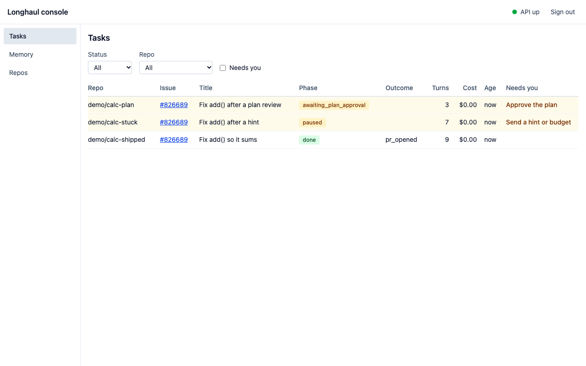
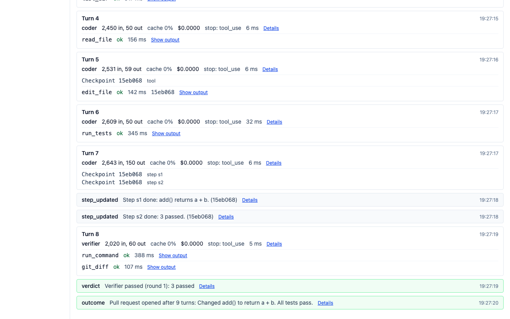
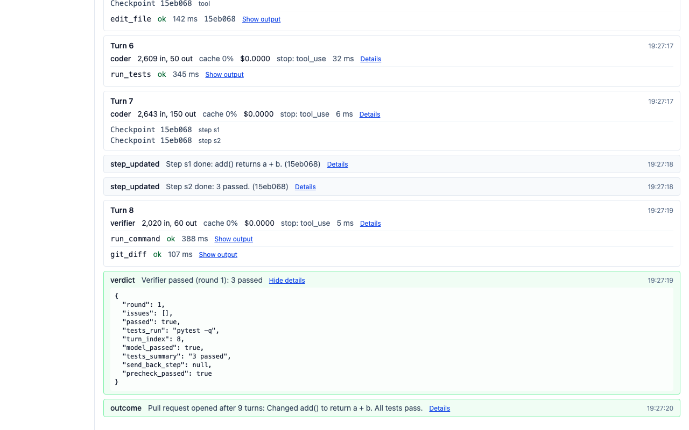
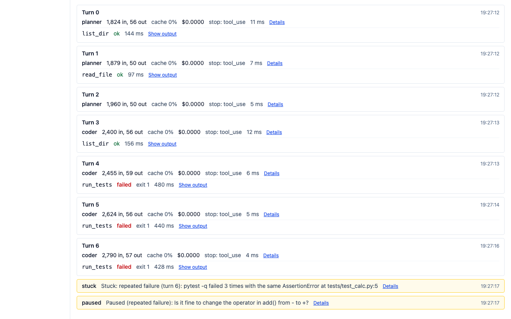
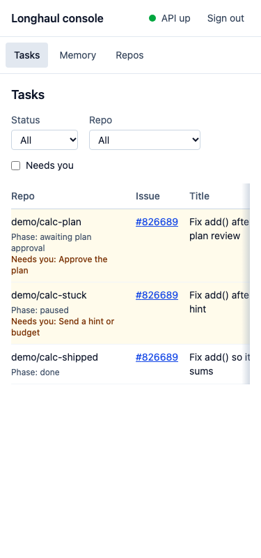

# Phase 9 gate: Evaluation, chaos, hardening and release

- Date: 2026-11-12
- Result: **Pass on code, v1.0.0 tagged.** The steps that need an Anthropic key, the eval VM, a recording or a logged-in GitHub account are listed under "Steps to close the gate": the eval numbers, the demo video, GitHub Pages and branch protection.

## Test summary

| Check | Result |
|---|---|
| `make gate PHASE=9`, first run at c44557d | ruff, ruff format and mypy clean; the marker run had 7784 passed, 9 failed and 1 error. Every failure came from the Docker VM losing its network and its clock during the run (`RequestTimeTooSkewed` from MinIO, pip unable to reach PyPI inside the sandbox). With the network back, the 10 tests passed on rerun. One e2e test failed for a real reason in CI first: see issue 1. |
| `make gate PHASE=9`, final run at e192706 | Green. ruff, ruff format and mypy clean; 6854 unit tests passed; the marker run (phases 0 to 9, chaos_lite and hardening included) had 7801 passed, 1 skipped and 0 failed in 38 minutes; the console checks passed (lint, typecheck, 203 vitest tests, build) and the Playwright main path passed. The skipped test is the live Keystone test, which needs a Keystone stack set up for this repo. |
| GitHub Actions `ci` | Green on every job at e192706 (the tree of the final gate run): unit, integration, e2e, console (lint, typecheck, tests, build, type generation check), console-e2e, lint, types, security (pip-audit and the gitleaks scan of every ref), docs, compose and terraform. |
| Final tree | The release tree adds LH-994 (the README and the docs site tell the story from the problem to the proof, with a chaos chart drawn from the summary file), four dependency updates (TypeScript 7 is held until its lint and API type tools allow it) and the Needs you wording of a paused task. CI is green on every job at edbedd9, and the console checks and the Playwright main path passed locally. |
| Replay | Histories recorded before the planned-finish review, the kept phase and the final report replay; removing any one of the three new patch checks makes its replay test fail with a nondeterminism error (gate review). They are committed under tests/fixtures/histories/. |
| Secrets | gitleaks 8.30.1 over every branch and tag: no leaks. CI now runs the same scan. pip-audit over every extra: no known vulnerabilities. |

## Acceptance criteria

| Story | Criterion | Evidence | Status |
|---|---|---|---|
| LH-901 | A scripted dry run (--config full --set custom --limit 2 --provider scripted) writes valid result files | tests/integration/test_eval_runner.py::test_dry_run_writes_results passed | Pass |
| LH-901 | The grader marks a known-good patch resolved and a known-bad patch unresolved | test_eval_runner.py::test_grader_good_bad passed | Pass |
| LH-901 | The agent's sandbox never contains hidden_tests (asserted) | test_eval_runner.py::test_hidden_tests_not_visible passed | Pass |
| LH-902 | Gold patch on 2 instances reports 2/2 resolved | tests/integration/test_swebench_adapter.py::test_gold_patch_sanity is marked slow and needs the SWE-bench images on the eval VM. Not run here. | Manual |
| LH-902 | Empty patch on the same 2 reports 0/2 | test_swebench_adapter.py::test_empty_patch_reports_zero_of_two (slow, eval VM). Not run here. | Manual |
| LH-902 | subset.txt has 40 ids with the stated split, generated from the seed | tests/unit/test_subset.py::test_stratified_counts passed. subset.txt has 40 ids. After uv sync --extra eval, `select_subset.py --check` loaded the dataset from HF and printed 'subset.txt matches a fresh draw: 40 ids, seed 42'. | Pass |
| LH-902 | A real 3-instance smoke run with the agent completes end to end | Needs a live model and the eval VM | Manual |
| LH-902 | Patch filter excludes test_patch files | tests/unit/test_patch_filter.py::test_excludes_test_patch_files passed | Pass |
| LH-903 | All three configs run on the scripted custom subset in a dry run | tests/integration/test_baselines.py::test_three_configs_dry_run passed . tests/unit/test_single_shot.py::test_patch_apply_fallback passed. | Pass |
| LH-903 | Result files record the config hash | test_baselines.py::test_config_hash_recorded passed | Pass |
| LH-903 | Same model id across configs enforced unless --allow-mixed-models | test_baselines.py::test_mixed_models_in_a_run_set_are_refused_before_a_task_starts passed. eval/run.py --help lists --run-set and --allow-mixed-models. | Pass |
| LH-904 | Running the suite produces the summary with all fields | The committed eval/results/chaos-2026-11-07/summary.json (20 runs) has every key in results.SUMMARY_FIELDS, and each run and kill has every key in RUN_FIELDS and KILL_FIELDS (checked with a script). The review did not run tests/chaos/test_chaos_full.py (marker chaos, left out of the gate) so as not to add a second compose project and its load while the gate ran. | Pass |
| LH-904 | Duplicate side-effect count is computed from FakeGitHub state, not our DB | eval/chaos/audit.py count_side_effects reads GitHubState from FakeGitHub (see its module docstring). The summary has duplicate_side_effects 0, missing 0 and 0 mismatched runs. The live check is test_chaos_full.py::test_the_side_effects_are_the_ones_fakegithub_holds, not run here (see above). | Pass |
| LH-904 | Each kill type hit at least 4 times across 20 runs (asserted) | tests/unit/test_chaos_plan.py::test_kill_type_coverage passed. In the committed summary the landed kills are worker 10, sandbox 11, temporal 9, postgres 9. | Pass |
| LH-904 | Recordings made with the real model (Build) | summary.json lists recordings: scripted for all 4 tasks. A real recording needs ANTHROPIC_API_KEY. README, case-study and results.md state this openly. | Manual |
| LH-905 | Running on dry-run fixtures produces the full page with every section | tests/integration/test_report_build.py passed: 9 tests, among them test_sections_present, test_footer_names_the_runs_and_the_commit and test_chaos_table_is_filled_from_the_summary. Building by hand with --allow-scripted chaos-2026-11-07 gives a chaos table identical to the one in the README. | Pass |
| LH-905 | Wilson and McNemar match reference values | tests/unit/test_stats.py::test_wilson and ::test_mcnemar passed, with 8 tests in the file | Pass |
| LH-906 | The hardening tests pass | tests/integration/test_sandbox_hardening.py::test_inspect_flags and ::test_the_flags_hold_inside_the_container passed against a live sandbox | Pass |
| LH-906 | docs/security.md maps each control to a test | tests/unit/test_security_page.py::test_every_test_named_on_the_page_exists passed, with 10 tests in the file. The two controls without a test are listed under 'Controls without a test', with the reason for each. | Pass |
| LH-906 | gitleaks and pip-audit clean or documented | gitleaks git --log-opts=--all --redact on the worktree: 583 commits, about 11.3 MB, no leaks found. uv export --frozen --all-extras then uvx pip-audit --no-deps --disable-pip: No known vulnerabilities found. The npm audit findings, all dev-only, are documented in security.md. | Pass |
| LH-907 | Fresh clone plus README quickstart reaches a finished scripted task in under 10 minutes on a clean machine | Not on a clean VM. A fresh clone of the branch on this machine went from `make setup` to the end of `make demo` in 118 s (the task itself 76 s) with warm caches; a cold machine adds the image pulls and the dependency download. No worker or sandbox was left. | Manual |
| LH-907 | Docs style tests pass (no banned phrases, no long dashes) | tests/unit/test_docs_style.py: 38 passed. The first run failed only because the archive copy had no git index (git ls-files exit 128). It passed after git init and git add in the copy, which lists the same 1101 files as the commit. | Pass |
| LH-907 | README per 11.1, architecture, runbook, case-study, demo-script present (Build) | The README has every 11.1 section: title, headline numbers, GIF placeholder, how it works, quickstart, run on your repo, results, design decisions, safety, limitations, license. The runbook has Start and stop, Drain a worker, Cancel stuck tasks, Rotate tokens, The replay test and Upgrade with workflow versioning. architecture.md has 3 mermaid diagrams. case-study.md and demo-script.md exist. | Pass |
| LH-907 | Demo video recorded; repo made public | The repo is public (an anonymous call to the GitHub API sees it, and gitleaks over every branch and tag found no leaks). The demo video and the README GIF are not recorded; docs/demo-script.md has the script and the checklist. | Manual |
| LH-908 | terraform validate passes in CI | Locally with Terraform 1.17.0 in deploy/terraform/aws: fmt -check -recursive is clean, init -backend=false -lockfile=readonly works, and validate prints 'Success! The configuration is valid.' The CI job `terraform` runs the same three steps. | Pass |
| LH-908 | docs/deploy-aws.md lists every resource and a teardown command | deploy-aws.md has a 'Resources and what they cost' table, one row per aws_* type, and `terraform destroy` at line 177, with the protect_data note | Pass |
| LH-909 | With Keystone and a curl-deny policy the agent sees a denied result and Keystone's audit log has every call | tests/integration/test_keystone_backend.py::test_denied_command_surfaces was skipped (KEYSTONE_URL not set). The Keystone containers on this machine belong to another project and would need an upstream, a policy and tokens set up, so this was not done. | Manual |
| LH-909 | direct mode unchanged (earlier tests pass) | tests/unit/test_activities_tools.py, test_registry.py and the integration batches (test_task_workflow, test_verifier and others) passed in direct mode | Pass |
| LH-991 | A planned finish is reviewed in a new run, and a history recorded before the change replays | tests/integration/test_verifier.py::test_finish_in_a_task_with_a_plan_is_reviewed_like_a_submission (asserts the lh-991-finish-reviewed marker) and ::test_a_history_that_ends_on_a_planned_finish_from_before_the_review_replays (fixture planned_finish_before_review.json, no marker) passed. Batch 2: verifier, run_report, api, outcomes and task_workflow, 292 passed in 320 s. | Pass |
| LH-991 | The stored run report names the final outcome | tests/integration/test_run_report.py::test_the_stored_report_names_the_final_outcome_and_lessons_after_the_wind_up and the LH-991 block of test_outcomes.py passed | Pass |
| LH-991 | Each source of the test command is used in its order | test_task_workflow.py::test_every_tool_call_carries_the_command_the_task_runs_its_tests_with (settings, then memory, then none) passed. tests/unit/test_activities_tools.py::test_run_tests_runs_the_command_the_task_names_before_the_worker_default and ::test_run_tests_falls_back_to_the_worker_default_when_the_task_names_none passed. Keystone mode carries the command through keystone_backend._context and mcp_server ... | Pass |
| LH-991 | API error mapping, decided_by, compact with role tools (Build) | tests/unit/test_api_errors.py (503, 400, 409, 502, no server message), test_promotion.py (decided_by, old approved_by still reads) and test_activities_context.py passed | Pass |
| LH-992 | Component tests cover each event kind and the fallback | console EventRow.test.tsx has one line each for step_updated (short sha), verdict pass and fail, outcome, paused, resumed, budget_added and compaction, plus the unknown-kind and bad-payload fallbacks. It passed with TasksPage and timeline tests (66 passed), and TaskPage.test.tsx passed 21, checkpoint marker included. Payload keys match the writers in task.py (compaction, budget_added, verdict). typecheck and lint ... | Pass |
| LH-992 | The Playwright main path checks the tasks table at 375 px | console/e2e/main-path.spec.ts sets a 375x800 viewport and checks that the phase and Needs you lines sit inside the scroll box and that its edge shows. make gate PHASE=9 on e192706 ran it: the Playwright main path passed. The console-e2e job is green in CI too. | Pass |
| LH-992 | Every test that docs/security.md names exists | tests/unit/test_security_page.py::test_every_test_named_on_the_page_exists passed. Trace redaction and 'worker never runs repo code' are mapped to tests (lines 69 and 99). The compose loopback and the default hosts are in the tested table (lines 120 and 121). | Pass |
| LH-992 | Timeline endpoint returns checkpoint rows | tests/integration/test_api.py::test_timeline_has_a_row_for_each_checkpoint passed | Pass |
| Integration checkpoint 9 | make gate PHASE=9 covers every phase marker, chaos_lite, Playwright and hardening | make gate PHASE=9 on e192706: every phase marker (0 to 9) including chaos_lite and the hardening tests, then console-check and console-e2e. See the test summary. | Pass |
| Integration checkpoint 9 | Manual smoke on the eval VM (select_subset --check, eval runs, grade, chaos, build_report) | Needs the eval VM and a model key. select_subset.py --check passed here (40 ids, seed 42); the smoke block of the plan now uses the commands as built (LH-993). | Manual |
| Phase gate 9 | All Must and Should stories Done. Could stories Done or moved to post-v1 with a note | docs/progress.md lists LH-901 to LH-909 and the fix stories LH-991, LH-992 and LH-993 as Done. The Could stories LH-908 and LH-909 are Done; LH-909's live Keystone test is the one skipped test on this machine. | Pass |
| Phase gate 9 | docs/results.md built from committed result files, footer run ids matching eval/results/ | docs/results.md says no real run has been made and holds no numbers; build_report.py refuses the scripted chaos run as headline data. eval/results/ holds only chaos-2026-11-07. The headline runs need an API key, the eval VM and the eval budget. | Manual |
| Phase gate 9 | Chaos summary committed. Recovery and duplicate numbers reported as they are | eval/results/chaos-2026-11-07 has summary.json and run-01 to run-20. The numbers in the README and the case study match it: completed 20/20, diff equal 20/20, 18 runs survived one to three kills (runs 17 and 18 had no kill land), 39 of 45 kills landed, 0 duplicate and 0 missing side effects, resume p50 2.0 s and p95 22.1 s. The answers are scripted, and the pages say so. The All row now counts 18 runs hit (LH-993). | Pass |
| Phase gate 9 | Hardening tests pass, and docs/security.md is complete | test_sandbox_hardening.py passed (2). test_security_page.py passed (10). Threat model, controls with tests, known gaps, rotation runbook, gitleaks, pip-audit and npm audit are all present. | Pass |
| Phase gate 9 | Fresh-clone quickstart under 10 minutes | Not on a clean VM; see LH-907 above (118 s on this machine with warm caches). | Manual |
| Phase gate 9 | README, case study and demo video done | README and case-study.md are done, with chaos numbers only and pending eval numbers stated. The demo video is not recorded. | Manual |
| Phase gate 9 | Repo public. Tag v1.0.0. Release notes per phase | The repo is public. v1.0.0 is tagged at the dev to main merge of this gate, and the tag message lists each phase's tag and highlights. A GitHub release object needs a logged-in gh, which this machine does not have. | Pass |

## Invariants

- I1 (pass): tests/unit/test_invariants.py passed (in the 519-pass unit batch)
- I2 (pass): test_invariants.py::test_payload_size_guard passed
- I3 (pass): tests/integration/test_sandbox.py::test_no_secrets_in_container_env and ::test_host_proxy_settings_do_not_reach_the_container passed. ENV_ALLOWLIST holds fixed values only and is never read from os.environ. exec merges the caller env onto the allowlist and no worker code passes os.environ to exec. test_clone_push.py::test_no_token_in_sandbox_or_ckpt_config passed.
- I4 (pass): test_invariants.py::test_github_writes_only_in_side_effects passed
- I5 (pass): tests/unit/test_branch_guard.py passed
- I6 (pass): The cost ledger tests (tests/integration/test_cost_ledger.py and the budget tests) are phase 7 markers and passed in make gate PHASE=9.
- I7 (pass): tests/unit/test_memory_retrieve.py passed
- I8 (pass): tests/unit/test_ci_config.py::test_no_secrets_in_ci passed: ci.yml sets LONGHAUL_PROVIDER to scripted and reads no model key or secret.
- I9 (pass): make gate PHASE=9 on e192706 is green: see the test summary.
- F13 / replay (pass): `uv run pytest tests/integration -k replay -q` in a clean copy of c44557d: 28 passed. Each of the three new patch checks was removed in turn in a copy, and each removal makes its replay test fail with a Temporal nondeterminism error. finish-reviewed is caught by planned_finish_before_review.json, keep-phase by handover_before_phase_kept.json (the second run of a hand-over, checked to carry continued_execution_run_id), and final-report by console_signals_before_mirror and ...

## Screenshots

Taken with Playwright on the final tree, against the demo stack of LH-808 (scripted provider, so every cost is $0.00).

The tasks list: each row shows the task's phase, turns, cost and outcome, and the two tasks that wait on a person say what they need.

The end of a shipped task: each event reads as one line (step updates with the short sha, the verdict, the outcome), with a checkpoint marker on the turn that made it.

The verdict with its details open: the full payload stays one click away.

A stuck task: the failing test runs show as failed with their exit code, then the stuck line with its evidence and the question the task paused on.

The tasks list at 375 px: the first column says the phase and what the task needs, and the table scrolls inside its box.

## Issues found

1. **The memory poisoning e2e test failed once the run report was written after the lessons (LH-991).** Task B drafts the rejected note again as a candidate, and the stored report lists its candidates. The report is written after B's last prompt, so nothing reached a prompt; the test now checks that the note appears only under "Candidate lessons". Fixed on the release branch.
2. **`make demo` left its worker running.** `$!` was the pid of a subshell, so the script stopped the subshell and the worker kept polling. Fixed by LH-993, with tests for the success, failure and interrupt paths.
3. **The docs said things that were no longer true:** the README linked the docs site as live, the demo script said the repo was not public, the AWS page said the API had no image, and the runbook said every pull request has one commit. Fixed by LH-993.
4. **The chaos table counted 20 runs hit in its All row, where 18 runs had a kill land.** Fixed by LH-993; the README table now says 18.
5. **The timeline showed a failing test run as ok, the stuck event as a raw payload, and a verdict one turn late.** Fixed by LH-993 (console) and on the release branch (the verdict records the turn that gave it).
6. **The CI secret scan covered less than the security page said.** CI now runs `gitleaks git --log-opts="--all"` with the version the page names, and a test ties the two together.
7. **An outage of the GitHub artifact store failed the unit job** after its tests passed. The coverage upload can no longer fail the job.
8. **A paused task said only "Paused" under Needs you.** It now says "Send a hint or budget", what a person does to resume it.
9. **A race in two plan gate tests showed up on the merge to main.** The tests sent a rejection as soon as the status showed the wait for a decision. The status shows that phase while the workflow still writes its task row, and a decision that is there before the workflow asks is taken without a request or a label, as designed. On the tag commit both CI runs hit that window in `test_the_third_rejection_ends_the_task_as_stuck`. The tests now answer the request once it is on the issue, as a person does (3440dce). The code did not change.
10. Minor items fixed along the way: the Prometheus scrape of the API, `memory list` without `--repo` in two hints, the worker test command in the runbook, the hand-over sentence in the workflow docstring, and the smoke commands of Integration checkpoint 9.

## Fix stories created

- LH-991 · Loose ends in the worker, the API and memory
- LH-992 · A readable timeline and a complete security page
- LH-993 · Release fixes from the gate review

LH-994 (the README and the docs site) and the dependency updates of the week landed with the release, outside the plan's stories.

## Steps to close the gate

- Gold patch on 2 instances reports 2/2 resolved: tests/integration/test_swebench_adapter.py::test_gold_patch_sanity is marked slow and needs the SWE-bench images on the eval VM. Not run here.
- Empty patch on the same 2 reports 0/2: test_swebench_adapter.py::test_empty_patch_reports_zero_of_two (slow, eval VM). Not run here.
- A real 3-instance smoke run with the agent completes end to end: Needs a live model and the eval VM
- Recordings made with the real model (Build): summary.json lists recordings: scripted for all 4 tasks. A real recording needs ANTHROPIC_API_KEY. README, case-study and results.md state this openly.
- Fresh clone plus README quickstart reaches a finished scripted task in under 10 minutes on a clean machine: Not on a clean VM. A fresh clone of the branch on this machine went from `make setup` to the end of `make demo` in 118 s (the task itself 76 s) with warm caches; a cold machine adds the image pulls and the dependency download. No worker or sandbox was left.
- Demo video recorded; repo made public: The repo is public (an anonymous call to the GitHub API sees it, and gitleaks over every branch and tag found no leaks). The demo video and the README GIF are not recorded; docs/demo-script.md has the script and the checklist.
- With Keystone and a curl-deny policy the agent sees a denied result and Keystone's audit log has every call: tests/integration/test_keystone_backend.py::test_denied_command_surfaces was skipped (KEYSTONE_URL not set). The Keystone containers on this machine belong to another project and would need an upstream, a policy and tokens set up, so this was not done.
- Manual smoke on the eval VM (select_subset --check, eval runs, grade, chaos, build_report): Needs the eval VM and a model key. select_subset.py --check passed here (40 ids, seed 42); the smoke block of the plan now uses the commands as built (LH-993).
- docs/results.md built from committed result files, footer run ids matching eval/results/: docs/results.md says no real run has been made and holds no numbers; build_report.py refuses the scripted chaos run as headline data. eval/results/ holds only chaos-2026-11-07. The headline runs need an API key, the eval VM and the eval budget.
- Fresh-clone quickstart under 10 minutes: Not on a clean VM; see LH-907 above (118 s on this machine with warm caches).
- README, case study and demo video done: README and case-study.md are done, with chaos numbers only and pending eval numbers stated. The demo video is not recorded.
- Turn on GitHub Pages. Done on 2026-11-12: the Pages source is GitHub Actions, `pages.yml` now deploys on each push to `main`, and the site is live at https://hoomanesteki.github.io/longhaul-autonomous-coding-agent-github/.
- LH-003 and LH-006: run `gh auth login`, then `scripts/protect_branches.sh` and the backlog import.
